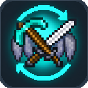

<p align="center">
  
</p>

<h1 align="center">MX Tool Swapper</h1>

<p align="center">
  A client-side Fabric mod for Minecraft 26.3 that puts the right item in your hand for you:<br>
  the best tool when mining, the best weapon when fighting and your elytra when you take off.
</p>

---

## Features

### Tool swapping
When you start mining a block, the mod searches your inventory for the fastest tool that still gets the block's drops and swaps it into your hand.
- A tool that breaks the block instantly is picked right away.
- Efficiency enchantments are taken into account.
- If the tool in your hand already mines the block properly, it stays in your hand.
- After the mod swapped your tool away, e.g. to a shovel for some dirt, you get back exactly that tool once it fits again, not just the fastest one.
- Silk touch and non-silk touch tools are kept apart: a silk touch tool is never swapped for a faster one without, and ordinary blocks use tools without silk touch first.
- Blocks that need silk touch, like glass, ender chests and ice, get a silk touch tool automatically. The list can be changed in the settings.
- If the best tool is in your hotbar, its slot is selected. Otherwise it is swapped into the current slot.

### Weapon swapping
When you attack a mob, the mod swaps to your strongest sword, or to your best axe if you have no sword.

### Elytra swapping
- Press jump in mid-air and an elytra from your inventory goes into your chest slot, so you start gliding right away.
- After you land, your chestplate goes back on.
- The elytra with the most durability left is used, and elytras about to break are skipped.

### Client-side only
All swaps are made with regular inventory clicks, so the mod works on vanilla servers and doesn't need to be installed on the server.

> Some servers consider automatic item swapping a utility mod. Check the server rules before using it.

## Configuration

All settings can be changed in game through [Mod Menu](https://modrinth.com/mod/modmenu) (Mods → MX Tool Swapper → Configure) or in `config/mxtoolswapper.json`.

| Setting | Default | Description |
|---|---|---|
| Enabled | on | Master switch for all features |
| Tool Swap Mode | Any | **Any**: swap to the best tool when mining. **Only Tools**: never swap away from a held sword. **No Swap**: never swap when mining |
| Keep Working Tool | on | Keep a held tool that mines the block properly. When off, swap to a faster tool, but never between silk touch and non-silk touch |
| Return to Previous Tool | on | After a swap, go back to exactly the tool you had before once it fits again |
| Swap Weapon | on | Swap to the best weapon when attacking. When off, a held sword is never swapped away while mining |
| Swap From Any Item | off | Also swap when holding a non-tool item or nothing |
| Show Toggle Message | on | Show a message above the hotbar when toggling with the key |
| Search Hotbar | on | Also use tools from the hotbar |
| Select Hotbar Slot | on | Select a hotbar tool's slot instead of moving it |
| Minimum Remaining Durability | 0 | Skip tools with this much durability left or less (0 = off) |
| Silk Touch for Listed Blocks | on | Mine the listed blocks with a silk touch tool if there is one |
| Silk Touch Blocks | glass, panes, ender chest, ice, … | Block ids (`minecraft:ender_chest`), block tags (`#minecraft:ice`) or ids with `*` as wildcard (`minecraft:*glass_pane`) |
| Auto-Equip Elytra | on | Equip an elytra when jumping in mid-air |
| Swap Armor Back After Landing | on | Put the previous chestplate back on after landing |
| Filter Type | Blocklist | Whether the filter list allows or blocks items |
| Filter Items | empty | Item ids (`minecraft:diamond_pickaxe`) or item tags (`#minecraft:axes`) |

### Key binding
**Toggle MX Tool Swapper** turns the whole mod on and off. It is unbound by default; set it under Options → Controls → Key Binds → MX Tool Swapper.

## Requirements

| Mod | Version |
|---|---|
| Minecraft | 26.3 |
| [Fabric Loader](https://fabricmc.net/) | 0.19.0 or newer |
| [Fabric API](https://modrinth.com/mod/fabric-api) | for 26.3 |
| [Cloth Config](https://modrinth.com/mod/cloth-config) | 26.3.x |
| [Mod Menu](https://modrinth.com/mod/modmenu) | optional, needed for the in-game settings screen |

## Installation

1. Install Fabric Loader for Minecraft 26.3.
2. Put Fabric API, Cloth Config and optionally Mod Menu into your `mods` folder.
3. Put `MXToolSwapper-<version>.jar` into your `mods` folder.

## Building

Building needs JDK 25.

```sh
./gradlew build
```

The jar is written to `build/libs/`. `./gradlew runClient` starts a development client with the mod installed.

## Tests

```sh
./gradlew runGameTest
```

runs the unit tests of the item choice (`ToolPicker`): which tool is picked for which block, efficiency, blocks that need the correct tool, the sword and axe choice, and every setting (modes, filter, minimum durability, hotbar search). They run on a headless server because item components, tags and enchantments are only loaded there.

```sh
./gradlew runClientGameTest
```

starts a game client, creates a survival world and checks swapping to the best tool from the inventory and the hotbar, swapping to a sword when attacking, that nothing happens while the mod is disabled, and the elytra swap from jumping in mid-air until landing. Every check also looks at the server, so the server must agree about the item in hand. Screenshots end up in `build/run/clientGameTest/screenshots/`.

## Credits

- The idea of tool and weapon swapping comes from the Tool Swapper upgrade in [Sophisticated Backpacks](https://github.com/P3pp3rF1y/SophisticatedBackpacks) by P3pp3rF1y. MX Tool Swapper is an independent implementation and contains no code from it.
- Elytra swapping is inspired by [Auto Swap](https://www.curseforge.com/minecraft/mc-mods/auto-swap).

## License

This mod is licensed under the [MIT License](LICENSE).
